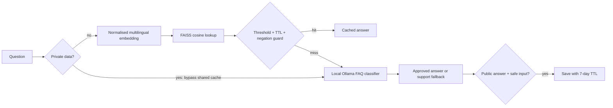

# Semantic FAQ Cache

A Python FAQ bot that reuses answers when questions mean the same thing. Built for a fictional Indian e-commerce store, with English and Hinglish evaluation questions. FastAPI serves a small chat UI; multilingual Sentence Transformers and FAISS handle retrieval; Ollama handles misses locally.

**Real dataset size: 30 FAQs and 100 labelled evaluation questions (60 paraphrases, 40 expected misses).** Benchmark results are generated by the evaluation command below; no latency or hit-rate claims are fabricated.



<!-- RESULTS START -->
## Measured results

Cache hit rate 17% on 100 test questions at threshold 0.75 with 0 false hits; LLM calls down 17%; average latency down from 721.9 ms to 597.0 ms.

| Threshold | Hit rate | False hits | LLM calls needed | Mean embed + lookup ms |
|---|---|---|---|---|
| 0.75 | 17% | 0 | 83 | 14.47 |
| 0.80 | 10% | 0 | 90 | 14.47 |
| 0.85 | 7% | 0 | 93 | 14.47 |
| 0.90 | 1% | 0 | 99 | 14.47 |
| 0.95 | 0% | 0 | 100 | 14.47 |

Warm embed + lookup mean at the selected threshold: 14.47 ms. The optional end-to-end run uses real local Ollama calls, not sleeps or simulated tokens. Hardware and package metadata are in `results/metrics.json`.

**Selection rule:** maximum hit rate subject to zero observed false hits; choose the higher threshold on ties. These are calibration-set measurements.

[Watch the measured three-question demo](results/demo.mp4). This video is rendered from `results/demo.json`; it is an event replay, not a browser screen recording.
<!-- RESULTS END -->

## Run locally

Requires Python 3.11+ and [Ollama](https://ollama.com/download). First run downloads the multilingual embedding model.

```bash
git clone https://github.com/adrijasaraswati/semantic-faq-cache.git
cd semantic-faq-cache
python -m venv .venv
# Linux/macOS: source .venv/bin/activate
# Windows PowerShell: .venv\Scripts\Activate.ps1
pip install -e '.[dev]'
ollama pull qwen2.5:0.5b
# Start `ollama serve` in another terminal if the service is not already running.
uvicorn faq_cache.api:app --host 127.0.0.1 --port 8000
```

Open http://localhost:8000 for the chat UI or http://localhost:8000/docs for the API. Cache hits work even when Ollama is unavailable. Misses return HTTP 503 if the local LLM is offline.

```bash
curl -X POST http://localhost:8000/ask -H 'Content-Type: application/json' -d '{"question":"Refund kab milega?"}'
```

## Deploy with Docker

```bash
docker compose up --build
```

Compose pulls the Ollama model before starting the app, keeps models and logs in volumes, and binds port 8000 to localhost. For a public deployment, use an authenticated TLS reverse proxy, rate limits, request quotas and tenant isolation. This repository provides a deployable local stack; it does not provision a paid cloud host. Do not expose the Ollama port publicly.

Configuration: `CACHE_THRESHOLD` (default 0.75, selected by calibration), `CACHE_TTL_DAYS` (7), `OLLAMA_URL`, `OLLAMA_MODEL`. Use one Uvicorn worker: each process owns an independent in-memory cache. Restart reseeds the 30 approved FAQs and discards learned entries. Expired entries are skipped during lookup; a production service should also compact them periodically.

## Reproduce the evaluation

```bash
pytest -q
python -m faq_cache.evaluate
# Optional real baseline vs cached latency; requires Ollama and may take several minutes:
python -m faq_cache.evaluate --llm
python -m faq_cache.demo
```

`data/faqs.json` contains 30 approved policies. `data/questions.json` contains 100 manually labelled synthetic questions: two paraphrases per FAQ, one English and one Hinglish, plus 40 unknown, personal or adversarial questions. `scripts/build_data.py` reproduces both files.

The threshold sweep uses **0.75, 0.80, 0.85, 0.90, 0.95** and a frozen cache. It reports hit rate over all 100 questions, wrong cached answers including hits on `none`, required LLM calls, and individually measured warm embedding + lookup latency. Ties choose the higher threshold. A threshold is selected only if false hits are zero; otherwise no threshold is recommended. The dataset is a calibration set, not an independent held-out test: selecting and reporting on it is optimistic. Validate on new traffic before deployment. Zero observed errors is not a guarantee of safety.

See `results/metrics.json`, `results/predictions.json` (all 500 decisions), and `results/thresholds.md` after running evaluation. Retrieval timings exclude LLM inference, HTTP and disk logging. Optional `--llm` compares 100 sequential uncached Ollama calls against the same questions with frozen caching; it writes actual end-to-end averages. LLM call savings equal cache hits; they are independent of inference speed.

## What the experiment taught us

The initial calibration confused refund timing with refund destination. Clarifying the destination FAQ cache key removed that observed collision. This is calibration-set iteration, so the final zero false-hit count needs confirmation on a fresh held-out set. At threshold 0.75, English paraphrase recall is 8/30 and Hinglish recall is 9/30; the conservative hit rate is a measured limitation, not a claim of complete FAQ coverage.

The end-to-end protocol runs the uncached baseline first and cached requests second on one CPU runner. The first baseline request can include Ollama model loading, and later requests can reuse its prompt cache. Results are one sequential run, without randomized ordering or confidence intervals; use repeated warm, interleaved trials for a production latency claim.

## Safety decisions

- Negation parity: if only one question contains `not`, `no`, `never`, `nahi`, `nahin`, `mat`, `नहीं` or `मत`, skip that candidate. Examples: “I want a refund” vs “I do not want a refund”; “Refund chahiye” vs “Refund nahi chahiye”; “Cancel the order” vs “Do not cancel the order”. Actual similarities and guard decisions appear in metrics. This simple guard misses double negation and implicit negation.
- Entries expire after 7 days, including policy answers. TTL is a freshness limit, not source validation; update the approved FAQ file when policies change.
- Inputs containing common private-data patterns bypass shared lookup. Such input is redacted in JSONL logs, and responses are never logged. Regex detection is deliberately conservative and incomplete: arbitrary names are not reliably detectable.
- The LLM selects an approved FAQ ID using structured JSON. Only approved answer text may enter the shared cache. Unknown responses are never cached. This constrains hallucinated policy and personal data, although an incorrect LLM classification can still pollute learned entries. Production should require a confidence gate or human review before promoting learned questions.
- No test-time learning during evaluation. The application does learn public misses; the separate cold-cache demo demonstrates that behavior.

Logs live in `runtime/requests.jsonl` and include question (or redaction), hit/miss, similarity, reason, latency in milliseconds, token count and timestamp. Hits use zero LLM tokens. Ollama token usage includes prompt and generated tokens.

## Interview talking points

1. Exact-match caching misses spelling changes and paraphrases. Semantic caching trades that extra recall for false-hit risk: a wrong cached refund policy is worse than a miss.
2. The threshold sweep makes the recall/precision tradeoff visible. Hard negatives, negation, expired policies and user-specific queries must be tested, not just easy paraphrases. Report per-language recall and use a fresh held-out set next.
3. At scale, move process-local FAISS into Redis/RedisVL SemanticCache, with tenant-scoped keys, explicit TTL, model/policy versions, bounded capacity and eviction. A customer's personal answer must never be reused for another customer.
4. Add per-tenant quotas, a single-flight lock for duplicate misses, encrypted logs with retention, and monitoring for false hits. Avoid storing PII embeddings in a shared cache.
5. The small 0.5B classifier is cheap to run but may misclassify. Evaluate its answer correctness independently; cache retrieval accuracy does not establish LLM answer accuracy.

## References

[Sentence Transformers encoding](https://www.sbert.net/docs/package_reference/sentence_transformer/SentenceTransformer.html), [FAISS cosine similarity](https://github.com/facebookresearch/faiss/wiki/MetricType-and-distances), [Ollama generate API](https://docs.ollama.com/api/generate).
